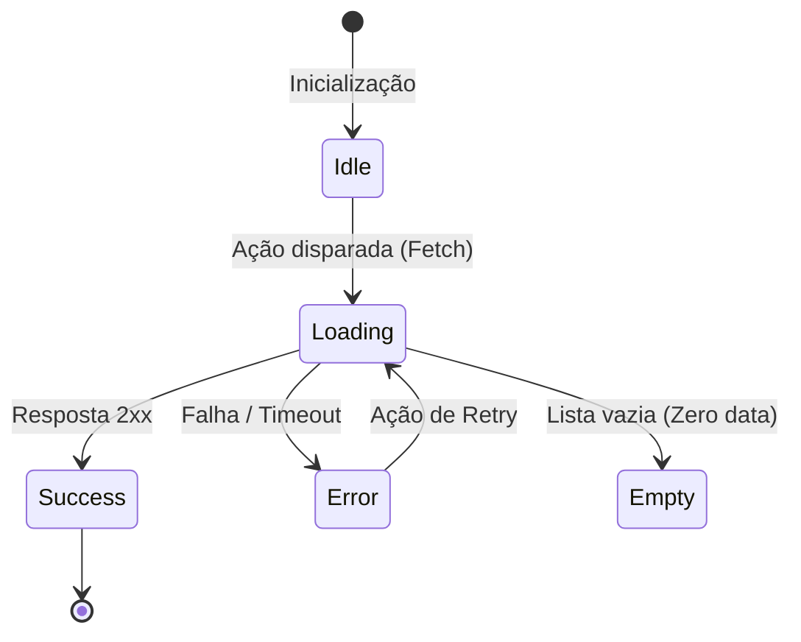

# Skill: Frontend Moderno & Arquitetura Web

Esta skill orienta o Agente Kiro na construção de interfaces de usuário escaláveis, resilientes e de alta performance, mantendo rigorosa separação de responsabilidades.

---

## 1. Arquitetura de Componentes e Estrutura de Pastas

Adotamos a separação por recursos (**Feature-Driven Architecture**) ou camadas limpas:

```text
src/frontend/
├── components/       # Componentes primitivos e reutilizáveis (Button, Input, Modal, Badge)
├── features/         # Módulos de domínio com seus componentes, hooks e serviços próprios
│   └── auth/
│       ├── components/   # LoginForm, RegisterCard
│       ├── hooks/        # useAuth, useSession
│       └── services/     # authApi.ts
├── layouts/          # Estruturas de página (MainLayout, AuthLayout, DashboardLayout)
├── hooks/            # Hooks customizados globais
├── context/          # Provedores de estado global
├── services/         # Clientes de API HTTP (Axios, Fetch Wrapper)
└── styles/           # Tokens CSS, temas globais, Tailwind/CSS-in-JS config
```

---

## 2. Gestão de Estado

1. **Estado do Servidor (Server State):**
   - Nunca armazene dados de API em estado global síncrono bruto sem estratégia de cache.
   - Utilize bibliotecas de Server State (ex: React Query / TanStack Query, SWR, RTK Query) para lidar com cache, revalidação em background, deduplicação de requisições e paginação.
2. **Estado Local:**
   - Mantenha o estado o mais próximo possível do componente que o consome.
   - Evite "prop drilling": se o dado for compartilhado por poucos níveis, passe via props; se for de escopo de sessão/tema/notificação, utilize Context API ou stores leves (Zustand, Pinia, Vue Reactivity).

---

## 3. Estados de Interface Obrigatórios

Todo componente conectado a operações assíncronas (chamadas de API, processamento) DEVE implementar os 4 estados fundamentais:



- **Loading:** Skeletons visuais ou spinners não-intrusivos (evite flashes de layout).
- **Empty State:** Ilustração ou texto explicativo com ação direta (Call To Action - ex: "Nenhum item cadastrado. Criar primeiro item").
- **Error State:** Mensagem humanizada e botão de repetição ("Tentar novamente").
- **Success/Data:** Renderização do conteúdo com transição suave.

---

## 4. Otimização de Performance

- **Code Splitting & Lazy Loading:** Rotas e modais pesados devem ser carregados dinamicamente via `dynamic import` / `lazy`.
- **Prevenção de Re-renderizações Desnecessárias:** Separe componentes com alto índice de alteração de componentes estáticos.
- **Otimização de Imagens e Mídia:** Use formatos modernos (WebP, AVIF) e defina dimensões explícitas para evitar CLS (Cumulative Layout Shift).

---

## 5. Checklist de Validação para o Agente Kiro

- [ ] Componente desacoplado de lógica de rede (lógica isolada em hooks/services).
- [ ] Implementados os estados de Carregando, Vazio, Erro e Sucesso.
- [ ] Nenhuma chave de API ou segredo exposto no bundle cliente.
- [ ] Componentes tipados (TypeScript) sem uso de `any`.
- [ ] Feedback visual instantâneo para ações do usuário (toasts, loading states).
