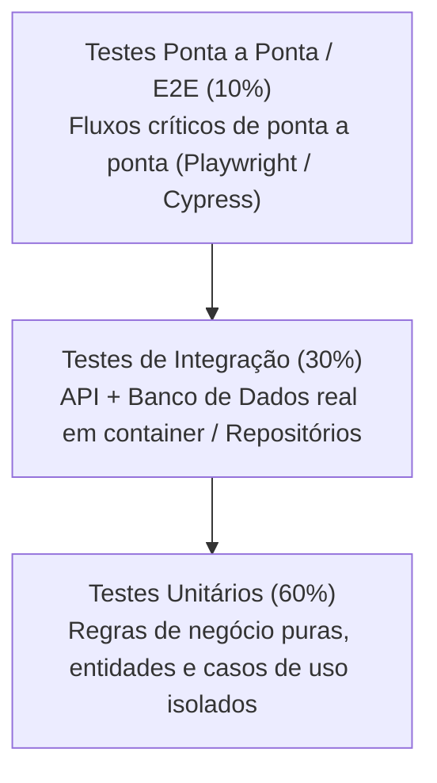

# Skill: Estratégia de Testes Automatizados & Qualidade

Esta skill orienta o Agente Kiro na criação de suítes de testes determinísticas, robustas e manuteníveis, garantindo que todo critério de aceite definido no `requirements.md` possua validação automatizada.

---

## 1. Pirâmide de Testes no Projeto



### 1.1 Testes Unitários
- **Foco:** Regras de negócio puras na camada de domínio e casos de uso.
- **Velocidade:** Execução em milissegundos, sem I/O de rede ou disco.
- **Isolamento:** Dependências de infraestrutura são substituídas por *Fakes* ou *Mocks* leves.

### 1.2 Testes de Integração
- **Foco:** Comunicação entre a aplicação e componentes reais de infraestrutura (banco de dados, cache, endpoints HTTP).
- **Ambiente:** Executar contra banco de dados real em container descartável (ex: Testcontainers ou SQLite em memória para testes rápidos).
- **Garantia:** Validação de transações, restrições de chaves e queries de banco.

### 1.3 Testes Ponta a Ponta (E2E)
- **Foco:** Jornadas de usuário críticas (ex: Cadastro -> Login -> Realizar ação principal -> Visualizar resultado).
- **Resiliência:** Seletores baseados em atributos semânticos ou de acessibilidade (`role`, `aria-label`, `data-testid`).

---

## 2. Testes Baseados em Propriedades (Property-Based Testing)

Recomendado pelo Kiro IDE para validação de algoritmos críticos:
- Em vez de testar apenas 2 ou 3 exemplos manuais, defina **invariantes matemáticas e de negócio** e utilize geradores aleatórios para submeter centenas de casos de borda ao código (ex: Hypothesis para Python, fast-check para TypeScript/JS, QuickCheck para Go/Rust).
- Exemplo de invariante: *"O saldo final de uma carteira nunca pode ser negativo, independentemente da sequência de transações recusadas."*

---

## 3. Padrão de Escrita de Testes: AAA (Arrange, Act, Assert)

Todo teste deve seguir visualmente as 3 seções:

```typescript
test('deve calcular desconto progressivo corretamente para usuário VIP', async () => {
  // 1. Arrange (Preparação do cenário e dados)
  const user = createFakeUser({ isVip: true });
  const cart = createFakeCart({ itemsTotal: 100 });
  const sut = new CalculateDiscountUseCase();

  // 2. Act (Execução da ação a ser testada)
  const result = await sut.execute({ user, cart });

  // 3. Assert (Validação das expectativas)
  expect(result.discountPercentage).toBe(15);
  expect(result.finalPrice).toBe(85);
});
```

---

## 4. Checklist de Validação para o Agente Kiro

- [ ] Cada tarefa em `tasks.md` possui pelo menos um teste unitário ou de integração associado.
- [ ] Testes não dependem da ordem de execução (são idempotentes e isolados).
- [ ] Cenários de borda foram cobertos: valores nulos, strings vazias, valores extremos, timeouts.
- [ ] Testes utilizam dados gerados deterministicamente ou fixtures limpas.
- [ ] Nenhum teste ignorado (`it.skip`, `@unittest.skip`) sem justificativa documentada.
