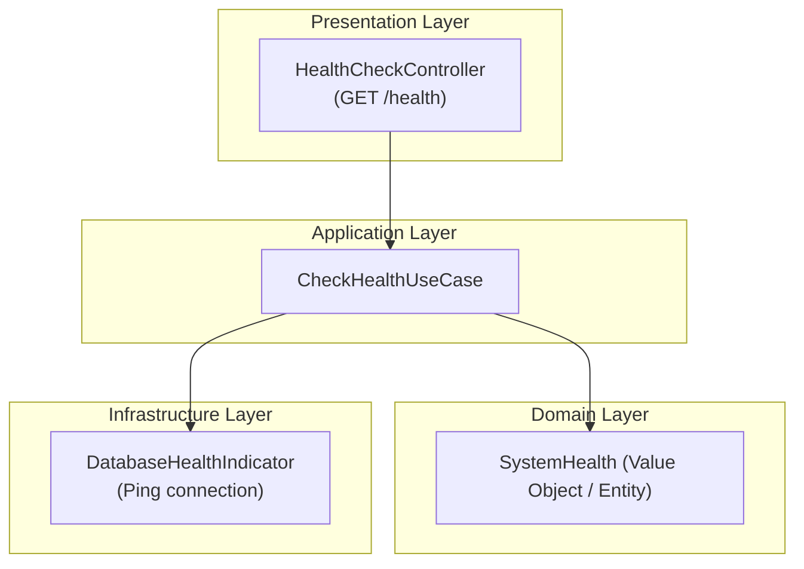
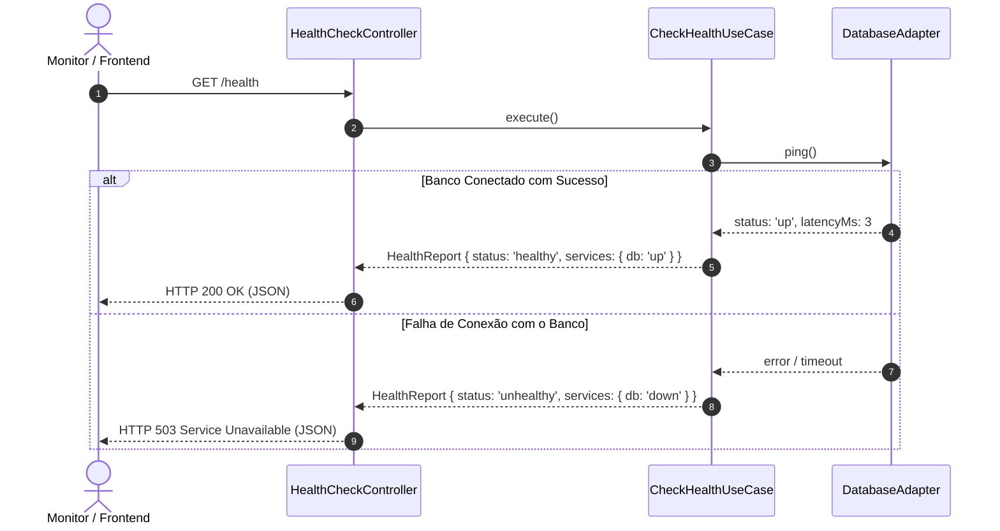

# Design Técnico: 001 - Fundação da Aplicação & Healthcheck Agnóstico

- **ID do Spec:** `SPEC-001`
- **Spec Relacionada:** `requirements.md`
- **Status:** Aprovada

---

## 1. Visão Geral da Arquitetura

O sistema implementa o endpoint de diagnóstico de saúde `/health` estruturado segundo os princípios da Clean Architecture.



---

## 2. Diagrama de Sequência do Healthcheck



---

## 3. Contrato de Resposta (JSON Schema)

```json
{
  "$schema": "http://json-schema.org/draft-07/schema#",
  "title": "HealthCheckResponse",
  "type": "object",
  "properties": {
    "status": {
      "type": "string",
      "enum": ["healthy", "degraded", "unhealthy"]
    },
    "timestamp": {
      "type": "string",
      "format": "date-time"
    },
    "version": {
      "type": "string"
    },
    "uptimeSeconds": {
      "type": "number"
    },
    "services": {
      "type": "object",
      "properties": {
        "database": {
          "type": "string",
          "enum": ["up", "down", "unknown"]
        }
      },
      "required": ["database"]
    }
  },
  "required": ["status", "timestamp", "version", "uptimeSeconds", "services"]
}
```

---

## 4. Estratégia de Frontend

O frontend inicial fornece um painel de status limpo desenvolvido com design tokens simples (ou Tailwind/CSS nativo), consumindo o endpoint `/health` em intervalo regular (polling a cada 10s ou revalidação sob demanda).

Componentes:
- `AppHeader`: Título do projeto e badge de status do ambiente.
- `HealthDashboardCard`: Exibe indicadores visuais para Backend e Banco de Dados.
- `SpecExplorer`: Acesso rápido e links para a documentação e specs da pasta `.kiro/specs/`.
