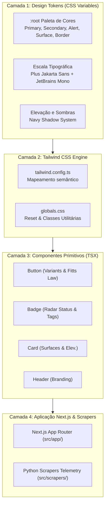

# Design Técnico: 002 - UI/UX Design System & Tokens PATA RADAR

- **ID do Spec:** `SPEC-002`
- **Spec Relacionada:** `requirements.md`
- **Status:** Aprovada

---

## 1. Visão Geral da Arquitetura Visual

O Design System do **PATA RADAR** é estruturado em camadas desacopladas:

---

## 2. Matriz de Contraste e Acessibilidade (WCAG 2.1 AA)

| Elemento | Cor de Fundo | Cor do Texto | Contraste | Nível WCAG |
|---|---|---|---|---|
| **Texto Base / Títulos** | `#F8FAFC` (Canvas) | `#0B1F3A` (Primary) | **16.5:1** | AAA (Excelente) |
| **Texto Secundário** | `#F8FAFC` (Canvas) | `#334155` (Muted) | **8.9:1** | AAA (Excelente) |
| **Botão Primário** | `#0B1F3A` (Primary) | `#FFFFFF` (Branco) | **17.5:1** | AAA (Excelente) |
| **Botão Secundário** | `#10B981` (Secondary) | `#0B1F3A` (Primary) | **7.1:1** | AAA (Excelente) |
| **Botão Alerta** | `#F59E0B` (Alert) | `#0B1F3A` (Primary) | **7.8:1** | AAA (Excelente) |
| **Card / Superfície** | `#FFFFFF` (Surface) | `#0B1F3A` (Text) | **17.5:1** | AAA (Excelente) |

---

## 3. Escala Tipográfica Padronizada

- **Display (Hero):** `40px` (2.5rem) / Line-Height: `1.15` / Weight: `800` (ExtraBold)
- **H1:** `30px` (1.875rem) / Line-Height: `1.25` / Weight: `700` (Bold)
- **H2:** `24px` (1.5rem) / Line-Height: `1.3` / Weight: `600` (SemiBold)
- **H3:** `20px` (1.25rem) / Line-Height: `1.4` / Weight: `600` (SemiBold)
- **H4:** `16px` (1rem) / Line-Height: `1.45` / Weight: `600` (SemiBold)
- **Body Large:** `18px` (1.125rem) / Line-Height: `1.6` / Weight: `400`
- **Body Base:** `16px` (1rem) / Line-Height: `1.5` / Weight: `400`
- **Body Muted:** `14px` (0.875rem) / Line-Height: `1.5` / Weight: `500`
- **Caption / Overline:** `12px` (0.75rem) / Weight: `600` / Uppercase
