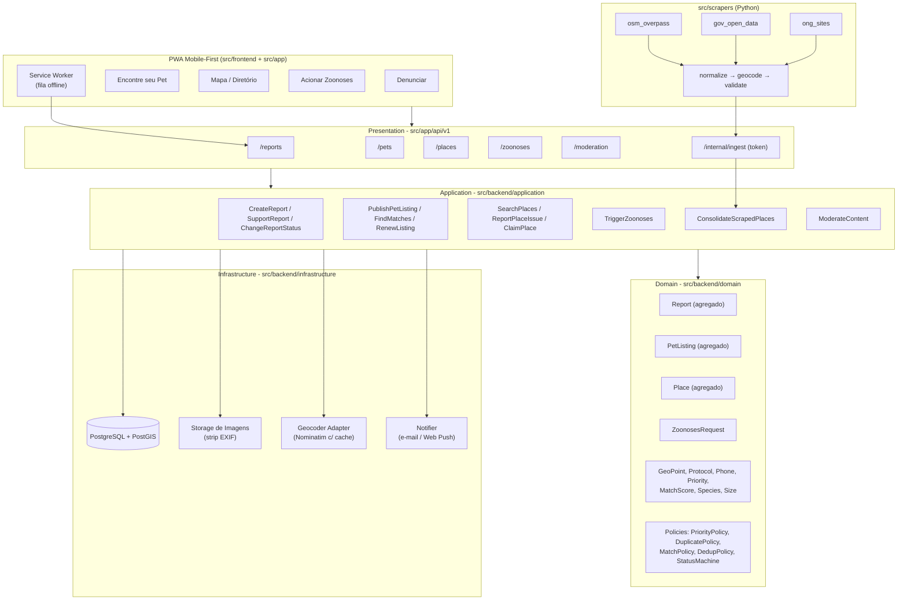
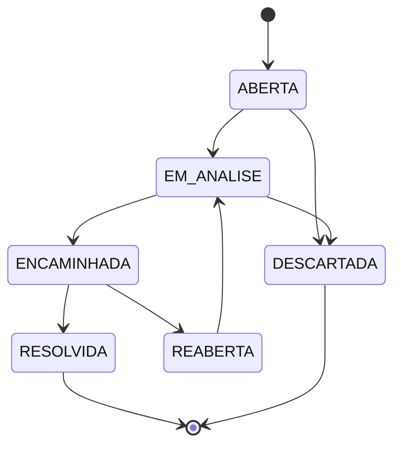
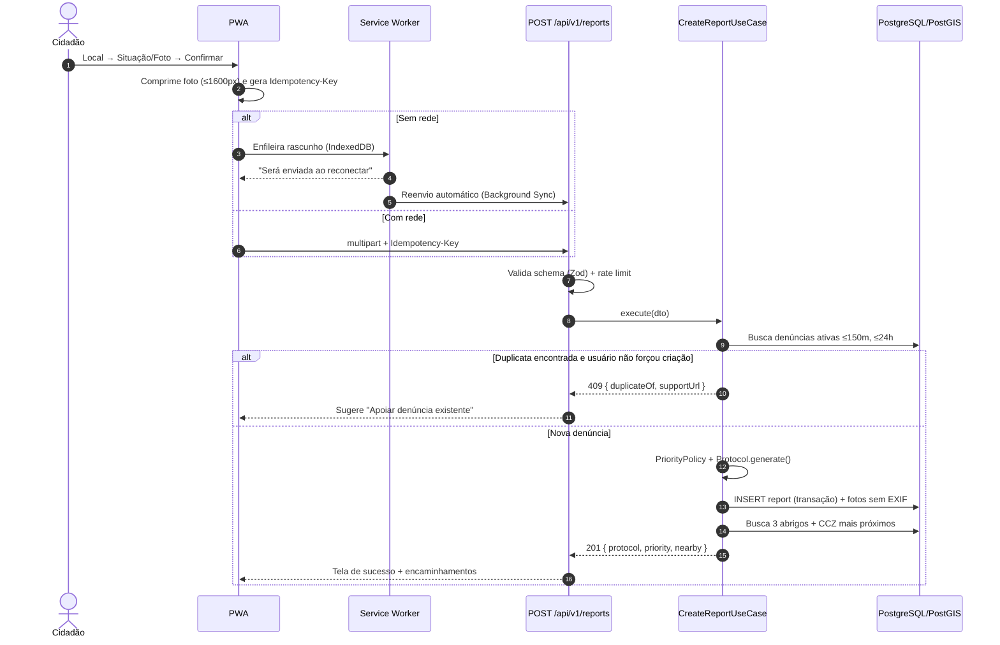
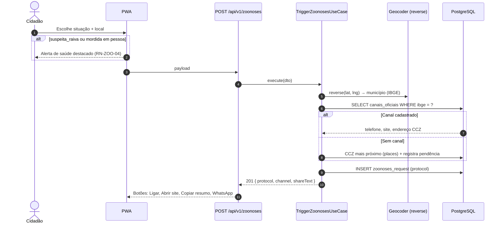
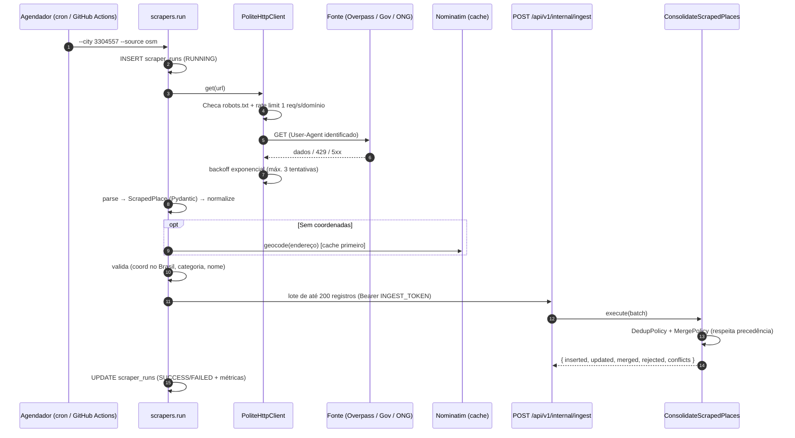
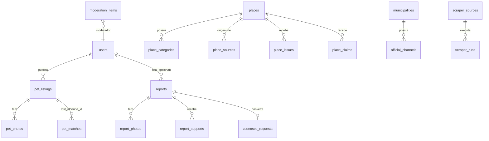
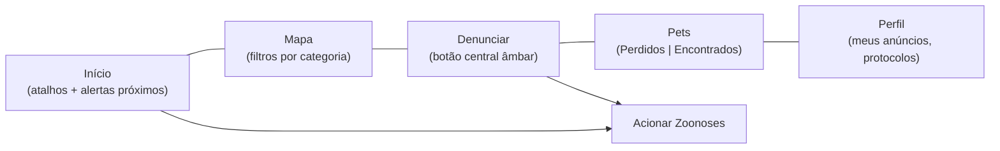

# Design Técnico: 003 - Regras de Negócio do PATA RADAR

- **ID do Spec:** `SPEC-003`
- **Spec Relacionada:** `requirements.md`
- **Status:** Proposta
- **Stack de Referência:** Next.js 14 (App Router) + TypeScript, PostgreSQL 16 + PostGIS, Python 3.12 (scrapers com Pydantic), Tailwind com tokens da `SPEC-002`

---

## 1. Arquitetura e Visão Geral

O sistema segue Clean Architecture (steering `tech-agnostic-architecture.md`). As rotas `src/app/api/v1/*` do Next.js atuam como **Presentation**; regras de negócio ficam puras em `src/backend/domain`. O módulo Python de scraping é um **driven adapter** independente que grava em tabelas de *staging* e chama um caso de uso de consolidação (via SQL function ou endpoint interno autenticado).



### 1.1 Estrutura de Pastas Prevista

```text
src/
├── app/
│   ├── (mobile)/                 # rotas de tela: /, /mapa, /denunciar, /pets, /zoonoses, /perfil
│   └── api/v1/                   # route handlers (Presentation)
├── backend/
│   ├── domain/
│   │   ├── shared/               # GeoPoint, Protocol, Phone, DomainError
│   │   ├── report/               # Report, ReportStatus, PriorityPolicy, DuplicatePolicy
│   │   ├── pet/                  # PetListing, MatchPolicy
│   │   ├── place/                # Place, PlaceCategory, TrustLevel, DedupPolicy, FreshnessPolicy
│   │   └── zoonoses/             # ZoonosesRequest, OfficialChannel
│   ├── application/              # use cases + ports (IReportRepository, IGeocoder, INotifier...)
│   ├── infrastructure/           # repositórios PG, storage, geocoder, notifier
│   └── presentation/             # validação Zod, mapeamento DTO, rate limit middleware
├── database/migrations/          # SQL versionado (PostGIS)
├── scrapers/
│   ├── core/                     # http_client (robots, rate limit, retry), models, normalize, dedup
│   ├── sources/                  # osm_overpass.py, gov_open_data.py, ong_sites.py
│   └── run.py                    # CLI: python -m scrapers.run --city 3304557 --source osm
└── shared/                       # enums e tipos compartilhados (TS)
```

---

## 2. Modelo de Domínio

### 2.1 Máquina de Estados da Denúncia (RN-DEN-05)



Implementação: `ReportStatusMachine.canTransition(from, to): boolean`, chamada em `Report.changeStatus()`, que lança `InvalidStatusTransition` em caso inválido.

### 2.2 Políticas de Domínio (funções puras)

| Política | Entrada | Saída | RN |
|---|---|---|---|
| `PriorityPolicy.calculate(situation, inProgress, confirmations)` | tipo, flag flagrante, nº confirmações | `CRITICA \| ALTA \| MEDIA` | RN-DEN-03, RN-DEN-07 |
| `DuplicatePolicy.isDuplicate(new, existing)` | duas denúncias | boolean (≤150 m, ≤24 h, mesma espécie/tipo, ativa) | RN-DEN-06 |
| `MatchPolicy.score(lost, found)` | dois anúncios | 0–100 | RN-PET-05, RN-PET-08 |
| `ListingExpiryPolicy.isExpired(listing, now)` | anúncio, data | boolean | RN-PET-04 |
| `FreshnessPolicy.status(place, now)` | estabelecimento | `ATUAL \| DESATUALIZADO \| OCULTO` | RN-DIR-05 |
| `DedupPolicy.isSamePlace(a, b)` | dois estabelecimentos | boolean | RN-SCR-06 |
| `MergePolicy.merge(a, b)` | dois estabelecimentos | estabelecimento fundido | RN-SCR-06, RN-SCR-09 |
| `LocationObfuscation.obfuscate(point, 300)` | ponto | ponto deslocado determinístico | RN-GER-04 |

### 2.3 Cálculo do Match (RN-PET-05)

```text
pré-filtro (eliminatório): tipo oposto, mesma espécie, mesmo porte, distância ≤ 5 km, |Δdatas| ≤ 15 dias
se microchip igual e não nulo → score = 100

distância  = 40 × (1 − d_km / 5)
cor        = 30 se cor igual; 15 se cor "parecida" (tabela de grupos de cor); 0 caso contrário
raça       = 15 se igual; 8 se um dos lados é SRD/desconhecido; 0 se diferentes
sexo       = 10 se igual; 5 se um dos lados desconhecido; 0 se diferentes
datas      = 5 × (1 − |Δdias| / 15)

score = round(soma) → notifica se score ≥ 60
```

### 2.4 Protocolo (RN-ZOO-05)

`Protocol.generate(date)` → `PR-` + `AAAAMMDD` + `-` + 5 caracteres de `[A-Z0-9]` sem ambíguos (`0/O`, `1/I`), gerados com CSPRNG. Unicidade garantida por índice `UNIQUE`; em colisão, nova tentativa (até 3).

---

## 3. Diagramas de Sequência

### 3.1 Denúncia com detecção de duplicidade e modo offline



### 3.2 Acionar Zoonoses



### 3.3 Pipeline de Scraping



---

## 4. Contratos de API (v1)

Todas as rotas sob `/api/v1`. Listagens paginadas por cursor (`?cursor=&limit=` com `limit ≤ 50`).

| Método | Rota | Auth | Descrição | RN |
|---|---|---|---|---|
| `POST` | `/reports` | opcional | Cria denúncia (anônima ou autenticada) | RN-DEN-01..09 |
| `POST` | `/reports/{id}/support` | opcional | Apoia denúncia existente | RN-DEN-06, 07 |
| `GET` | `/reports/protocol/{protocol}` | não | Acompanha por protocolo | RN-GER-03 |
| `GET` | `/reports?bbox=` | não | Denúncias públicas no mapa | RN-DEN-10, 11 |
| `PATCH` | `/reports/{id}/status` | moderador | Altera status | RN-DEN-05 |
| `POST` | `/pets` | sim | Publica anúncio perdido/encontrado | RN-PET-01..03, 09 |
| `GET` | `/pets?type=&species=&lat=&lng=&radiusKm=` | não | Busca anúncios ativos | RN-PET-04 |
| `GET` | `/pets/{id}/matches` | dono | Lista matches | RN-PET-05 |
| `POST` | `/pets/{id}/renew` | dono | Renova por 30 dias | RN-PET-04 |
| `POST` | `/pets/{id}/close` | dono | Reencontrado/devolvido | RN-PET-06 |
| `GET` | `/places?lat=&lng=&radiusKm=&category=&openNow=&verified=` | não | Busca no diretório | RN-DIR-02, 03 |
| `GET` | `/places/{id}` | não | Detalhe + atribuição | RN-SCR-07 |
| `POST` | `/places/{id}/issues` | sim | Reporta fechado/endereço/telefone errado | RN-DIR-06 |
| `POST` | `/places/{id}/claim` | sim | Reivindica estabelecimento | RN-DIR-07 |
| `POST` | `/zoonoses` | opcional | Aciona zoonoses | RN-ZOO-01..05 |
| `PATCH` | `/zoonoses/{protocol}/official-protocol` | opcional | Informa protocolo oficial | RN-ZOO-06 |
| `POST` | `/content/{type}/{id}/flag` | sim | Denuncia conteúdo | RN-MOD-02 |
| `GET` | `/moderation/queue` | moderador | Fila de moderação | RN-MOD-01 |
| `POST` | `/internal/ingest` | token de serviço | Recebe lote do scraper | RN-SCR-06, 08, 09 |

### 4.1 `POST /reports` — Entrada

```json
{
  "location": { "lat": -22.9068, "lng": -43.1729, "reference": "Em frente à padaria" },
  "species": "dog",
  "situation": "ferido",
  "inProgress": false,
  "description": "string (opcional, máx 500)",
  "photos": ["upload-id-1"],
  "anonymous": true,
  "forceCreate": false
}
```

Header obrigatório: `Idempotency-Key: <uuid-v4>` (RN-MOB-03).

### 4.2 `POST /reports` — Saída `201`

```json
{
  "id": "uuid",
  "protocol": "PR-20261029-K7Q2M",
  "status": "ABERTA",
  "priority": "CRITICA",
  "createdAt": "2026-10-29T14:03:00Z",
  "nearby": {
    "shelters": [{ "id": "uuid", "name": "Abrigo X", "distanceKm": 1.2 }],
    "zoonoses": { "id": "uuid", "name": "CCZ Y", "distanceKm": 4.8 }
  }
}
```

### 4.3 `GET /places` — Item de resposta

```json
{
  "id": "uuid",
  "name": "Clínica Veterinária Exemplo",
  "categories": ["VETERINARIO", "VETERINARIO_24H"],
  "address": { "street": "Rua Exemplo, 100", "neighborhood": "Centro", "city": "Rio de Janeiro", "state": "RJ", "zip": "20000000" },
  "location": { "lat": -22.9, "lng": -43.17 },
  "distanceKm": 0.8,
  "phone": "+5521900000000",
  "whatsapp": null,
  "openingHours": "24/7",
  "openNow": true,
  "trustLevel": "COLETADO",
  "freshness": "ATUAL",
  "attribution": "© colaboradores do OpenStreetMap"
}
```

### 4.4 Contrato do Scraper — `ScrapedPlace` (Pydantic)

```python
class ScrapedPlace(BaseModel):
    source: Literal["osm", "gov", "ong_site", "manual"]
    source_id: str                     # id externo (ex.: "node/123456")
    source_url: HttpUrl
    license: str                       # ex.: "ODbL-1.0"
    name: str = Field(min_length=2, max_length=150)
    categories: list[PlaceCategory] = Field(min_length=1)
    street: str | None = None
    neighborhood: str | None = None
    city: str
    state: str = Field(pattern=r"^[A-Z]{2}$")
    zip: str | None = Field(None, pattern=r"^\d{8}$")
    ibge_code: str | None = Field(None, pattern=r"^\d{7}$")
    lat: float = Field(ge=-33.8, le=5.3)      # bounding box Brasil
    lng: float = Field(ge=-73.99, le=-34.7)
    phone_e164: str | None = Field(None, pattern=r"^\+55\d{10,11}$")
    website: HttpUrl | None = None
    opening_hours: str | None = None
    content_hash: str                  # sha256 dos campos normalizados
    scraped_at: datetime
```

### 4.5 Mapeamento de Tags OSM → Categorias

| Tag OSM | Categoria PATA RADAR |
|---|---|
| `amenity=veterinary` | `VETERINARIO` (+ `VETERINARIO_24H` se `opening_hours=24/7`) |
| `amenity=animal_shelter` | `ABRIGO_ADOCAO` |
| `amenity=animal_boarding` | `ABRIGO_ADOCAO` (somente se `animal_shelter:adoption=yes`), senão ignorar |
| `shop=pet` | `CASA_RACAO_PETSHOP` |
| `shop=agrarian` + `agrarian=feed` | `CASA_RACAO_PETSHOP` |

CCZ, hospitais veterinários públicos e castração gratuita vêm de fontes governamentais ou cadastro manual (não há tag OSM confiável).

---

## 5. Modelo de Dados (PostgreSQL + PostGIS)



### 5.1 Tabelas Principais

| Tabela | Campos-chave | Observações |
|---|---|---|
| `users` | `id uuid PK`, `email`, `phone`, `verified_at`, `role` (`user`,`partner`,`moderator`,`admin`), `suspended_until` | Soft delete + anonimização (RN-GER-06) |
| `reports` | `id`, `protocol UNIQUE`, `user_id NULL FK`, `species`, `situation`, `in_progress`, `priority`, `status`, `location geography(Point,4326)`, `is_private_address`, `support_count`, `idempotency_key UNIQUE`, `created_at`, `closed_at` | `user_id` nulo = anônima |
| `report_supports` | `report_id FK`, `device_hash`, `user_id NULL` | `UNIQUE(report_id, device_hash)` |
| `pet_listings` | `id`, `user_id FK`, `type` (`LOST`,`FOUND`), `species`, `size`, `color`, `breed`, `sex`, `microchip_hash`, `event_at`, `location geography`, `public_location geography`, `status` (`ACTIVE`,`EXPIRED`,`REUNITED`,`RETURNED`,`HIDDEN`), `expires_at`, `renewals` | `microchip_hash` = SHA-256 (RN-PET-08) |
| `pet_matches` | `lost_id`, `found_id`, `score`, `notified_at` | `UNIQUE(lost_id, found_id)` |
| `places` | `id`, `name`, `name_normalized`, `location geography`, endereço, `ibge_code`, `phone_e164`, `whatsapp`, `website`, `opening_hours`, `trust_level`, `origin`, `revalidated_at`, `locked_fields text[]`, `status` (`VISIBLE`,`HIDDEN`,`REVIEW`) | `locked_fields` = campos editados por parceiro/moderador (RN-SCR-09) |
| `place_categories` | `place_id`, `category` | PK composta |
| `place_sources` | `place_id`, `source`, `source_id`, `source_url`, `license`, `content_hash`, `scraped_at` | `UNIQUE(source, source_id)` → upsert idempotente |
| `place_issues` | `place_id`, `user_id`, `type`, `created_at` | `UNIQUE(place_id, user_id, type)` |
| `municipalities` | `ibge_code PK`, `name`, `state`, `has_channel` | |
| `official_channels` | `ibge_code FK`, `kind` (`phone`,`site`,`email`,`address`), `value`, `source_url`, `verified_at`, `verified_by` | Somente moderador edita |
| `zoonoses_requests` | `id`, `protocol UNIQUE`, `situation`, `human_bite`, `location`, `ibge_code`, `official_protocol`, `status`, `report_id NULL FK` | |
| `scraper_sources` | `id`, `name`, `base_url`, `status` (`ACTIVE`,`DEGRADED`,`DISABLED`), `consecutive_failures` | RN-SCR-11 |
| `scraper_runs` | `id`, `source_id FK`, `ibge_code`, `started_at`, `finished_at`, `status`, `collected`, `inserted`, `updated`, `merged`, `rejected`, `error_summary` | RN-SCR-10 |
| `moderation_items` | `id`, `target_type`, `target_id`, `reason`, `flags_count`, `status`, `decided_by`, `decided_at`, `decision_reason` | Append-only para auditoria (RN-MOD-04) |

### 5.2 Índices

- `GIST` em `reports.location`, `pet_listings.location`, `places.location` (busca por raio com `ST_DWithin`).
- `GIN (name_normalized gin_trgm_ops)` em `places` (similaridade de nome via `pg_trgm` para RN-SCR-06).
- `places(phone_e164)`, `reports(status, created_at)`, `pet_listings(status, type, species, expires_at)`.

---

## 6. Módulo de Scraping — Design Detalhado

### 6.1 Componentes (`src/scrapers/core`)

| Componente | Responsabilidade | RN |
|---|---|---|
| `PoliteHttpClient` | `robots.txt` (urllib.robotparser) com cache, token bucket 1 req/s/domínio, retry com backoff (1s, 2s, 4s) em 429/5xx, timeout 20 s, User-Agent `PataRadarBot/1.0 (+contato)` | RN-SCR-03 |
| `normalize.py` | telefone E.164, CEP, UF, Title Case, remoção de emojis, `name_normalized` (minúsculas, sem acento, sem "clínica/pet shop") | RN-SCR-05 |
| `geocode.py` | Nominatim com cache SQLite local, 1 req/s, descarta fora do bbox do Brasil | RN-SCR-04 |
| `hashing.py` | `content_hash` = sha256 dos campos normalizados ordenados | RN-SCR-08 |
| `ingest_client.py` | envia lotes de 200 ao `/internal/ingest` com `INGEST_TOKEN` | RN-SCR-08 |
| `run.py` | CLI, registra `scraper_runs`, atualiza `consecutive_failures` | RN-SCR-10, 11 |

### 6.2 Fontes (`src/scrapers/sources`)

1. **`osm_overpass.py`** — Query Overpass por área do município (`area["ref:IBGE"="3304557"]`) com as tags da seção 4.5. Uma única requisição por cidade/categoria; sem necessidade de geocodificação.
2. **`gov_open_data.py`** — Leitores configuráveis (CSV/JSON/HTML) para listas públicas de CCZ, castração gratuita e hospitais veterinários públicos. Cada fonte é declarada em `sources.yaml` com URL, licença e parser.
3. **`ong_sites.py`** — Parsers específicos para páginas de ONGs/abrigos que permitam coleta (BeautifulSoup; Playwright só se a página exigir JS). Cada site entra apenas após checagem manual de termos.

### 6.3 Consolidação (`ConsolidateScrapedPlaces`)

```text
para cada registro do lote:
  1. procura place_sources(source, source_id)
     → existe e content_hash igual: atualiza revalidated_at; fim
     → existe e hash diferente: atualiza campos NÃO presentes em locked_fields;
       se campo bloqueado divergir → cria moderation_item(CONFLICT)
  2. senão, busca candidatos: mesmo phone_e164 OU ST_DWithin(50m) AND similarity(name) ≥ 0.85
     → candidato encontrado: MergePolicy (precedência PARCEIRO > MODERADOR > SCRAPING recente > USUARIO)
       e vincula novo place_source
     → nenhum: INSERT place (trust_level=COLETADO, origin=SCRAPING)
tudo dentro de uma transação por lote
```

---

## 7. Frontend Mobile-First

### 7.1 Navegação



### 7.2 Uso dos Tokens (SPEC-002)

| Elemento | Token |
|---|---|
| Header, títulos, bottom nav ativa | `--color-primary` |
| Botão "Denunciar", prioridade ALTA, selo "desatualizado" | `--color-alert` / `--color-alert-subtle` |
| "Reencontrado", "Verificado", "Aberto agora", foco | `--color-secondary` / `--color-secondary-subtle` |
| Prioridade CRÍTICA, alerta de raiva, erros | `--color-danger` / `--color-danger-subtle` |
| Cards de estabelecimento e anúncio | `--color-surface`, `--color-border`, `--shadow-md` |

### 7.3 Componentes Novos

`BottomNav`, `ReportWizard` (3 passos), `LocationPicker` (GPS + pin + endereço), `PhotoCapture` (compressão + preview), `PlaceCard`, `PetCard`, `MatchBanner`, `ProtocolTicket` (copiar/compartilhar), `HealthAlert`, `SensitiveImage` (blur), `OfflineBanner`. Todos com estados Loading, Empty, Error e Success.

Mapa: Leaflet + tiles OSM (atribuição obrigatória) para evitar custo e manter coerência de licença.

---

## 8. Segurança, Privacidade e Tratamento de Erros

### 8.1 Matriz de Segurança

| Risco | Mitigação | RN |
|---|---|---|
| Vazamento de localização residencial | Strip EXIF no servidor (sharp), ofuscação 300 m, ocultar endereço privado em maus-tratos | RN-GER-04, 07, RN-DEN-11 |
| Spam / denúncias falsas | Rate limit por IP + device hash, confirmações, moderação por flags | RN-DEN-08, RN-MOD-02 |
| Golpe de resgate | Aviso fixo, contato mediado, moderação prioritária | RN-PET-07 |
| Upload malicioso | Validação de MIME real (magic bytes), limite 5 MB, reencode da imagem | RN-PET-03 |
| Abuso da rota de ingestão | Token de serviço em variável de ambiente, rota fora do público, limite de lote | RN-SCR-08 |
| Injeção SQL | Queries parametrizadas via ORM/driver | skill `banco` |
| Dados pessoais no scraping | Lista de campos permitidos no `ScrapedPlace`; nada fora do contrato é persistido | RN-SCR-12 |

### 8.2 Erros de Domínio → HTTP

| Erro de Domínio | HTTP | Comportamento na UI |
|---|---|---|
| `ValidationError` | `400` | Destaca campos inválidos |
| `Unauthenticated` | `401` | Solicita login (mantém rascunho) |
| `Forbidden` | `403` | Mensagem de permissão |
| `NotFound` | `404` | Mensagem contextual |
| `DuplicateReport` | `409` | Oferece "Apoiar denúncia existente" ou "Criar mesmo assim" |
| `InvalidStatusTransition` | `422` | Mensagem para moderador |
| `RateLimitExceeded` | `429` | Informa tempo de espera |
| `ListingLimitReached` | `422` | Informa limite de 10 anúncios |
| Erro inesperado | `500` | Mensagem amigável; log sem dados pessoais |

---

## 9. Estratégia de Testes

- **Unitários (domínio, Vitest):** uma suíte por política da seção 2.2, cobrindo limites exatos (149 m/151 m, 24 h, 30 dias, score 59/60, 3 confirmações).
- **Property-Based (fast-check):** `MatchPolicy.score` sempre entre 0 e 100 e simétrico; `ReportStatusMachine` nunca alcança estado fora do diagrama; `LocationObfuscation` sempre a ≤ 300 m e determinística.
- **Integração (API + PostGIS em container):** busca por raio, upsert idempotente de `place_sources`, deduplicação por telefone e por proximidade+nome.
- **Scrapers (pytest):** `PoliteHttpClient` com relógio simulado (rate limit) e `robots.txt` mock; fixtures de respostas Overpass reais salvas em arquivo; normalização de telefones/CEP; rejeição fora do bbox.
- **E2E (Playwright, viewport 360×640):** fluxo de denúncia em 3 telas, modo offline com envio posterior, busca no mapa com filtro, acionamento de zoonoses.
- **Acessibilidade:** axe-core nas telas principais (validação completa exige teste manual com leitor de tela).
