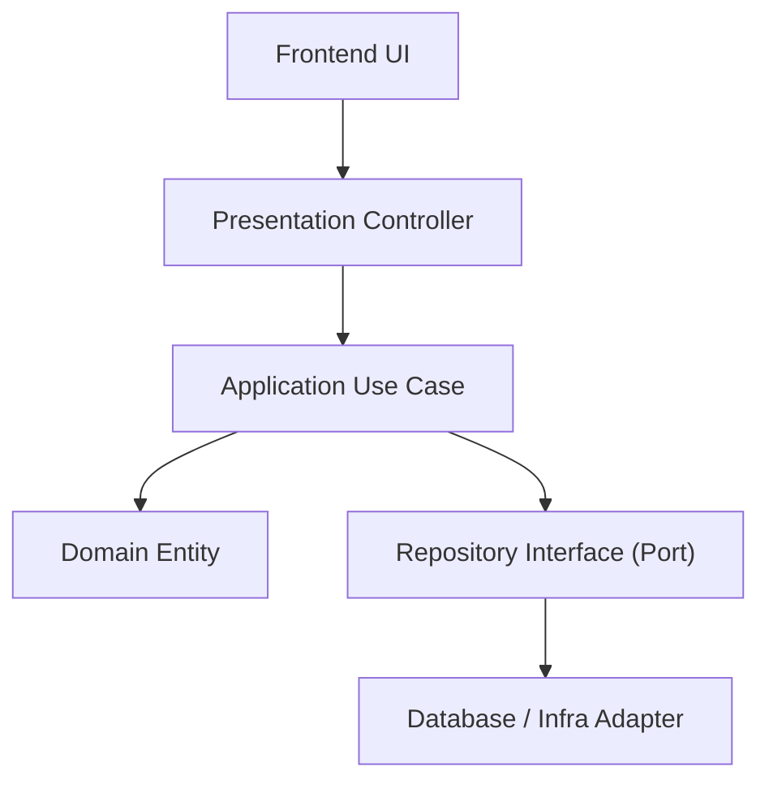
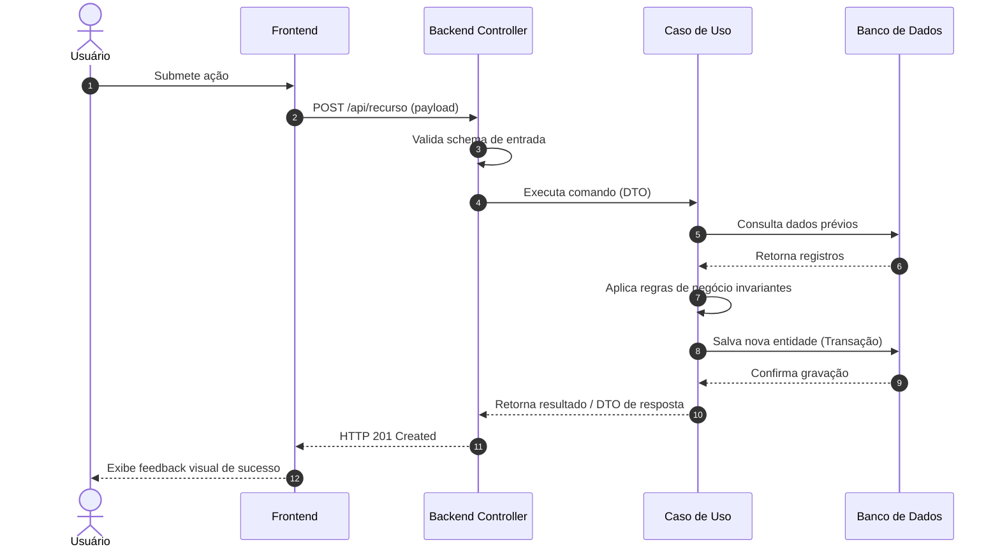

# Design Técnico: [Nome da Funcionalidade]

- **ID do Spec:** `SPEC-[NUMERO]`
- **Spec Relacionada:** `requirements.md`
- **Status:** Proposta | Em Revisão | Aprovada

---

## 1. Arquitetura e Visão Geral da Solução

Descreva a abordagem técnica escolhida, padrões de projeto aplicados e como os componentes se comunicam entre as camadas.



---

## 2. Diagrama de Sequência



---

## 3. Contratos de Dados e Interfaces

### 3.1 DTO de Entrada (Input Schema)
```json
{
  "campoExemplo": "string (obrigatório, min 3, max 100)",
  "valorNumerico": 100,
  "ativo": true
}
```

### 3.2 DTO de Saída (Output Response)
```json
{
  "id": "uuid-v4",
  "campoExemplo": "string",
  "valorNumerico": 100,
  "criadoEm": "2026-10-29T12:00:00Z"
}
```

---

## 4. Modelo de Dados e Persistência

- **Tabelas / Coleções:** `nome_tabela`
- **Campos Principais:**
  - `id`: UUID / Primary Key
  - `usuario_id`: UUID / Foreign Key -> `usuarios(id)`
  - `created_at`: TIMESTAMPTZ DEFAULT CURRENT_TIMESTAMP
  - `updated_at`: TIMESTAMPTZ DEFAULT CURRENT_TIMESTAMP
- **Índices Previstos:**
  - `idx_nome_tabela_usuario_id` ON `nome_tabela(usuario_id)`

---

## 5. Estratégia de Tratamento de Erros

| Código de Erro | Condição | Ação do Sistema |
|---|---|---|
| `400 Bad Request` | Payload fora do schema | Retorna lista de erros de campo inline |
| `401 Unauthorized` | Token ausente ou inválido | Redireciona para tela de login |
| `403 Forbidden` | Usuário sem permissão | Exibe alerta de acesso não autorizado |
| `404 Not Found` | Recurso não localizado | Exibe mensagem contextual |
| `409 Conflict` | Registro duplicado (chave única) | Alerta que o recurso já existe |
| `500 Internal Error`| Falha inesperada no servidor | Registra log seguro e exibe erro amigável |

---

## 6. Estratégia de Testes

- **Testes Unitários:** Testar caso de uso com mocks de repositório cobrindo cenários felizes e lançamentos de exceções de domínio.
- **Testes de Integração:** Executar chamada à rota via Supertest / TestClient gravando e consultando o banco de dados.
- **Testes de Borda:** Testar payloads vazios, strings com caracteres especiais, dados duplicados e limite de tamanho.
