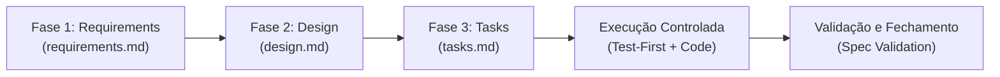

# SDD Methodology (Spec-Driven Development) para Kiro IDE

Este projeto adota **Spec-Driven Development (SDD)** como metodologia central de engenharia e colaboração com Agentes de Inteligência Artificial no Kiro IDE.

> **Princípio Fundamental:** Nenhuma linha de código de produção deve ser gerada sem antes existir uma especificação versionada, validada e aprovada nas 3 fases do ciclo SDD.

---

## O Ciclo SDD em 3 Fases (.kiro/specs/)

Todo trabalho no repositório (funcionalidade, melhoria, refatoração ou correção de bug) deve residir em `.kiro/specs/<id-da-feature>/` e seguir rigorosamente o fluxo:

### 1. Fase 1: Requisitos (`requirements.md`)
- **Objetivo:** Definir com clareza cristalina **o que** o sistema deve fazer e **por que**, sem antecipar detalhes de código prematuramente.
- **Padrão EARS (Easy Approach to Requirements Syntax):**
  - *Ubíquo:* "O sistema deve [ação]..."
  - *Baseado em Evento:* "QUANDO [evento ocorrer], o sistema deve [ação]..."
  - *Baseado em Estado:* "ENQUANTO [estado ativo], o sistema deve [ação]..."
  - *Comportamento Indesejado:* "SE [condição de erro/falha], ENTÃO o sistema deve [mitigação/resposta]..."
  - *Opcional:* "ONDE [recurso habilitado], o sistema deve [ação]..."
- **Critérios de Aceite:** Devem ser testáveis de forma determinística (pass/fail).

### 2. Fase 2: Design e Arquitetura (`design.md`)
- **Objetivo:** Definir a solução técnica antes da implementação.
- **Elementos Obrigatórios:**
  - Visão geral da arquitetura e componentes envolvidos.
  - Diagramas de fluxo e sequência em Mermaid (`sequenceDiagram`, `flowchart`).
  - Contratos de interface e dados (schemas JSON/OpenAPI, DTOs, entidades).
  - Estratégia de persistência e modelo de dados.
  - Matriz de segurança e tratamento de exceções.
  - Estratégia de testes (Unitários, Integração, Property-Based Testing).

### 3. Fase 3: Lista de Tarefas (`tasks.md`)
- **Objetivo:** Dividir o design em etapas atômicas, sequenciais e rastreáveis.
- **Formato:** Checkboxes `- [ ]` com identificadores explícitos (ex: `Task 1.1`, `Task 1.2`).
- **Rastreabilidade:** Cada tarefa deve referenciar qual critério de aceite ou componente do `design.md` ela satisfaz.
- **Execução:** O Kiro IDE pode disparar subagentes paralelos apenas para tarefas que não possuam dependências bloqueantes entre si.

---

## Regras de Execução para Agentes IA

1. **Anti-Vibe-Coding:** Nunca gere código através de prompts livres ou ad-hoc. Se o usuário solicitar uma alteração sem spec, oriente a criação ou atualização do spec correspondente.
2. **Atualização Atômica de Status:** Após concluir cada item no código e passar os testes, marque o checkbox correspondente em `tasks.md` com `- [x]`.
3. **Escopo Fechado:** Não refatore nem adicione código fora da tarefa atualmente ativa.
4. **Alinhamento Contínuo:** Se durante o desenvolvimento for identificado um erro ou lacuna no design, atualize o `design.md` antes de escrever a solução no código.
