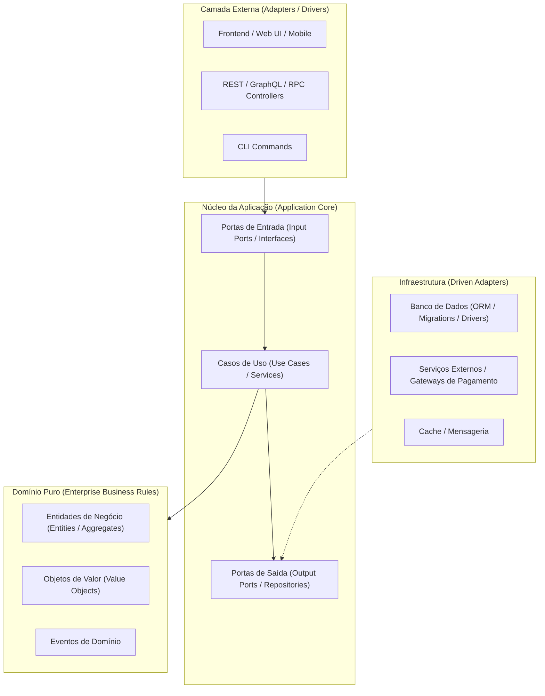

# Diretrizes Arquiteturais Agnósticas (Clean Architecture & Ports and Adapters)

Este documento define os princípios arquiteturais fundamentais do projeto. Como a linguagem e o framework de implementação podem ser selecionados de acordo com os requisitos do hackathon, esta estrutura garante desacoplamento total entre as regras de negócio e a infraestrutura tecnológica.

---

## 1. Princípios da Arquitetura Limpa (Clean Architecture)

Independentemente da linguagem adotada (TypeScript/Node.js, Python/FastAPI, Go, C#/.NET, Java/Spring, etc.), o código deve respeitar a Regra de Dependência: **o domínio nunca depende de infraestrutura, banco de dados ou frameworks externos**.



---

## 2. Divisão de Camadas no Repositório

```text
src/
├── backend/
│   ├── domain/         # Entidades puras, regras de negócio invariantes, exceções de domínio
│   ├── application/    # Casos de uso (Use Cases), DTOs, interfaces de serviços e repositórios
│   ├── infrastructure/ # Implementações de banco (repositórios concretos), clientes HTTP externos, cache
│   └── presentation/   # Controllers, rotas, middlewares, validação de payload externo
├── frontend/           # Aplicação visual do usuário (UI, componentes, hooks, views)
├── database/           # Schemas, migrations, seeds e scripts SQL/NoSQL agnósticos
└── shared/             # Tipagens compartilhadas, constantes universais e utilitários
```

---

## 3. Regras para o Agente Kiro na Seleção Tecnológica

Quando o time definir a stack tecnológica no hackathon:
1. **Mapeie os padrões:** Se escolher TypeScript, utilize interfaces nativas e Zod/Prisma; se escolher Python, utilize Pydantic, SQLAlchemy/Tortoise; se escolher Go, utilize structs e interfaces de pacotes nativos.
2. **Preserve a separação:** Nunca importe decorators de ORM ou bibliotecas HTTP (FastAPI, Express, Gin) dentro da pasta `domain/`.
3. **Inversão de Controle (IoC):** Repositórios e adaptadores externos devem ser injetados nos casos de uso através de contratos/interfaces abstratas.
