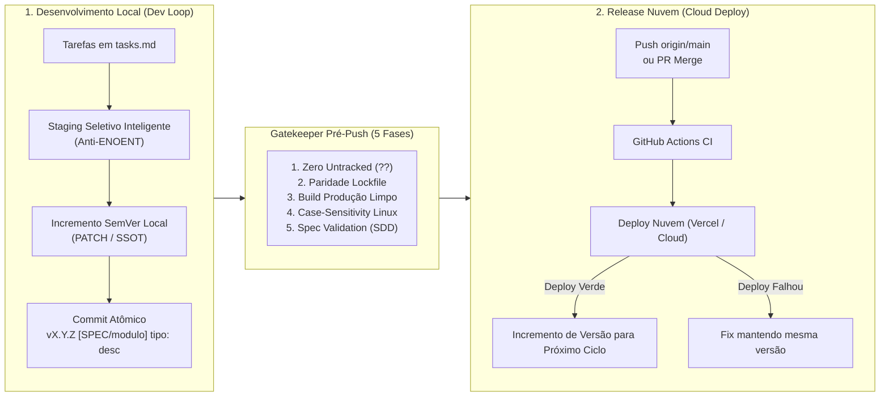

# 📚 Hub de Governança de Commits: Local & Cloud (Hackathon Estácio)

Este documento é a fonte única da verdade (SSOT) para o ciclo de vida de código, convenções de versionamento e homologação de releases da equipe no **Hackathon Estácio**, operando em conjunto com o **Kiro IDE** e a metodologia **Spec-Driven Development (SDD)**.

A governança está estruturada em dois pilares especializados:

---

## 📑 Navegação Rápida entre Políticas

### 1. 🛠️ [Política de Commits Locais, Staging Seletivo e Rastreabilidade SDD](./commit-policy-local.md)
- **Quando usar:** Durante o ciclo de desenvolvimento diário de features, bugfixes, refatorações locais e resolução de tarefas do `tasks.md`.
- **Principais Diretrizes:**
  - Incremento SemVer contínuo a cada commit local (**PATCH** por padrão; **MINOR**/**MAJOR** mediante solicitação explícita).
  - Sincronização do quarteto SSOT de versão (`package.json`, `version.ts`, `index.json`, `{nova_versao}.json`).
  - **Staging Seletivo Inteligente:** Proibição de `git add .` cego; inclusão mandatória de todos os novos arquivos criados (`??`) para erradicar falhas `ENOENT` em servidores Linux.
  - Auditoria preventiva de Case-Sensitivity (Windows vs Linux).
  - Formato obrigatório de mensagem: `vX.Y.Z [SPEC-ID / modulo] tipo: descrição`.
  - Checklist local pré-commit executável.

---

### 2. 🚀 [Política de Release Nuvem, Gatekeeper Pré-Push e Deploy Oficial](./commit-policy-cloud.md)
- **Quando usar:** No momento de abrir Pull Requests, consolidar branches na `main` e homologar o deploy de produção para a banca do hackathon.
- **Principais Diretrizes:**
  - **Gatekeeper Pré-Push (5 Fases Inegociáveis):**
    1. Auditoria de arquivos não rastreados (`git status -s`).
    2. Paridade e integridade do lockfile (`package-lock.json` ou `pnpm-lock.yaml`).
    3. Build limpo de produção (`npm run build` ou equivalente da linguagem com código `0`).
    4. Auditoria de Case-Sensitivity rigorosa no Git (`git ls-files`).
    5. Validação de integridade SDD (specs aprovadas e `tasks.md` atualizadas).
  - Protocolo de envio para branch `main` e disparo de pipelines (GitHub Actions / Vercel).
  - Monitoramento ativo de logs de deploy e plano de contingência para falhas.
  - **Incremento Condicional Pós-Deploy Verde:** A versão de produção só sobe após o deploy ficar 100% ativo e sem erros.
  - Governança de changelogs amigáveis (sem termos técnicos de código) com identificação clara para os jurados.

---

## 🤖 Integração com o Kiro IDE

Os agentes de IA do Kiro IDE devem carregar automaticamente estas regras via steering (`.kiro/steering/git-workflow-conventions.md`) e acioná-las sempre que comandos como `"faça o commit local"`, `"prepare o release"`, `"suba para a nuvem"` ou `"commit-cloud"` forem solicitados.
