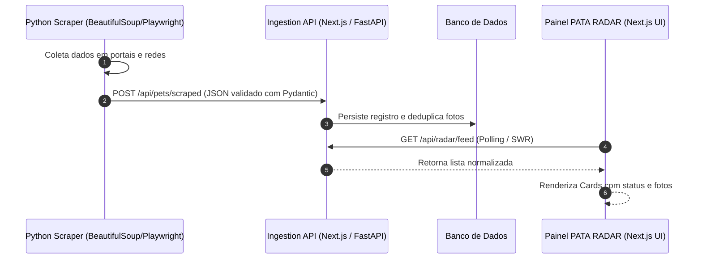

# 🎨 PATA RADAR - Manual de Identidade Visual e UI/UX Design System

> **Nome do Projeto:** PATA RADAR  
> **Stack:** Next.js 14 (App Router) + TypeScript, Python (Web Scraping), Tailwind CSS  
> **Conformidade:** WCAG 2.1 AA (Acessibilidade Digital)

---

## 1. Paleta de Cores Oficial

A paleta de cores foi calibrada para transmitir alta credibilidade tecnológica (Radar, Inteligência) aliada à causa animal.

```css
:root {
  --color-primary: #0B1F3A;    /* Azul Marinho Profundo */
  --color-secondary: #10B981;  /* Verde Esmeralda (Sucesso / Ativo) */
  --color-alert: #F59E0B;      /* Âmbar / Alerta (Scrapers em Execução) */

  --color-background: #F8FAFC; /* Slate 50 (Fundo Geral) */
  --color-surface: #FFFFFF;    /* Branco Puro (Cards e Tabelas) */
  --color-text: #0B1F3A;       /* Texto Primário de Alto Contraste */
  --color-text-muted: #334155; /* Slate 700 (Texto Secundário e Legendas) */
  --color-border: #E2E8F0;     /* Slate 200 (Divisórias Estruturais) */
}
```

### Matriz de Contraste e Aplicação
- **Primary (`#0B1F3A`):**
  - Uso: Cabeçalhos, navbar, títulos de seções, botão principal de ação (CTA).
  - Contraste contra o fundo `#F8FAFC`: **16.5:1 (Nível AAA)**.
  - Botão Primário com texto `#FFFFFF`: **17.5:1 (Nível AAA)**.
- **Secondary (`#10B981`):**
  - Uso: Status de radar online, pulso de atividade, confirmações e ações de sucesso.
  - Botão secundário com texto `#0B1F3A`: **7.1:1 (Nível AAA)**.
- **Alert (`#F59E0B`):**
  - Uso: Avisos, animais perdidos que requerem atenção urgente, scrapers ativos.
  - Botão de alerta com texto `#0B1F3A`: **7.8:1 (Nível AAA)**.
- **Background (`#F8FAFC`) & Surface (`#FFFFFF`):**
  - Uso: Estruturação em camadas (Canvas -> Cards com borda `#E2E8F0` e sombra suave).

---

## 2. Tipografia e Hierarquia Visual

- **Fonte Primária (Interface & Headings):** `Plus Jakarta Sans` (ou `Inter`)
- **Fonte Monospaçada (Telemetria, Código & Scrapers):** `JetBrains Mono`

### Escala de Tamanhos e Pesos

| Nível | Tamanho | Line Height | Peso | Tracking | Cor Padrão |
|---|---|---|---|---|---|
| **Display / Hero** | `40px` (2.5rem) | `1.15` | ExtraBold (800) | `-0.025em` | `--color-primary` |
| **Heading 1 (H1)** | `30px` (1.875rem) | `1.25` | Bold (700) | `-0.02em` | `--color-primary` |
| **Heading 2 (H2)** | `24px` (1.5rem) | `1.3` | SemiBold (600) | `-0.015em` | `--color-primary` |
| **Heading 3 (H3)** | `20px` (1.25rem) | `1.4` | SemiBold (600) | `-0.01em` | `--color-primary` |
| **Heading 4 (H4)** | `16px` (1rem) | `1.45` | SemiBold (600) | `normal` | `--color-primary` |
| **Body Large** | `18px` (1.125rem) | `1.6` | Regular (400) | `normal` | `--color-text` |
| **Body Base** | `16px` (1rem) | `1.5` | Regular (400) | `normal` | `--color-text` |
| **Body Muted** | `14px` (0.875rem) | `1.5` | Medium (500) | `normal` | `--color-text-muted` |
| **Caption / Overline**| `12px` (0.75rem) | `1.4` | SemiBold (600) | `0.05em` | `--color-text-muted` (Caps) |

---

## 3. Componentes Primitivos e Estados

### 3.1 Botões (`src/frontend/components/ui/Button.tsx`)
- Respeitam a **Lei de Fitts**: altura mínima de toque de 44px em telas sensíveis ao toque.
- Estados obrigatórios: *Idle*, *Hover*, *Active*, *Focus-Visible* (anel verde esmeralda `ring-secondary`), *Loading* (spinner integrado com desabilitação de clique) e *Disabled*.

### 3.2 Badges & Radar Pulse (`src/frontend/components/ui/Badge.tsx`)
- Tags de status com suporte a ponto indicador (`withDot`) e animação pulsante (`pulsing`) para indicar telemetria em tempo real.

### 3.3 Cards & Superfícies (`src/frontend/components/ui/Card.tsx`)
- Fundo `#FFFFFF`, borda `#E2E8F0`, raio de borda de 12px (`rounded-xl`), com elevação sutil `shadow-sm`.

---

## 4. Integração Frontend (Next.js) + Scrapers (Python)


